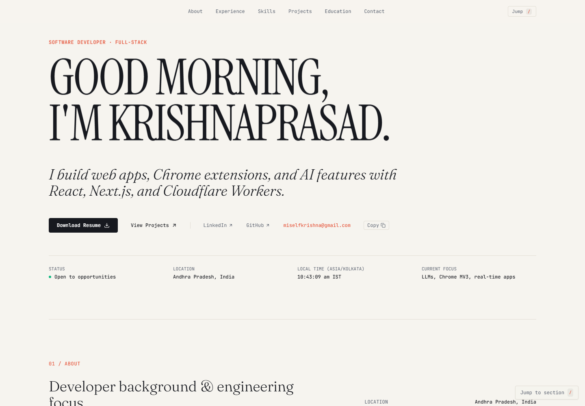

# Portfolio — Mundru Krishnaprasad

Personal developer portfolio: a single-page site covering about, experience, skills, projects, education and contact.

**Live:** <https://mundrukrishnaprasad.github.io>

[](https://mundrukrishnaprasad.github.io)

## What is included

- Editorial-style hero with availability, location and current focus.
- About, experience, skills, selected projects and education sections.
- Project cards for the full-stack, Cloudflare and Chrome-extension work, including the live Dispatch and Sundial products, the multi-cloud failover demo and the AWS EKS lab.
- Responsive layout, scroll-reveal animation, project ring, marquee ticker and mobile navigation.
- Resume download, GitHub, LinkedIn and email links.

## Structure

| File | Purpose |
| --- | --- |
| `index.html` | Page structure, content and inline theme config |
| `style.css` | Theme variables, layout, project cards, animation and responsive rules |
| `script.js` | Preloader, 3D project ring, scroll reveals, mobile navigation, copy actions |
| `docs/portfolio.png` | Current home page screenshot |

No framework and no build step. The page is plain HTML, CSS and JavaScript, with Tailwind loaded from its CDN for utility classes.

## Editing

- Editable content is marked in `index.html` with `<!-- EDIT -->` comments.
- Colours and spacing live in the `:root` variables at the top of `style.css`.
- Sections: About, Experience, Skills, Projects, Education and Contact.
- Update the resume link, social URLs and email in the hero and contact sections.

## Run locally

Open `index.html` directly, or serve the folder:

```bash
npx serve .
```

## Deployment

Pushes to `main` publish automatically through GitHub Pages from the repository root.

## Stack

HTML · CSS · JavaScript · Tailwind CSS (CDN) · GitHub Pages
